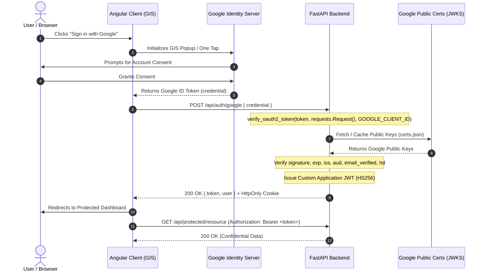

# Google OAuth 2.0 Production-Grade Authentication Guide & Backend Service (Python / FastAPI)

> **Enterprise Architecture & Security-Hardened Implementation Guide**  
> *Target Stack: Python (FastAPI / `google-auth` / `PyJWT`) Backend & Angular Frontend Client (Google Identity Services GIS)*  
> **Repository:** [github.com/abhishektech007/google-auth-library](https://github.com/abhishektech007/google-auth-library)

---

## 1. Executive Summary

Modern enterprise authentication strictly decouples **identity establishment** from **API resource authorization**:

1. **Authentication (Who you are)**: Proved via an **OpenID Connect (OIDC) ID Token** — a cryptographically signed JSON Web Token (JWT) issued by Google certifying the user's identity.
2. **Authorization (What you can access)**: Delegated via **OAuth 2.0 Access Tokens** designed to query external Google APIs (e.g. Gmail API, Google Drive API) on the user's behalf.

### The Security Anti-Pattern vs. Production Architecture

* **Anti-Pattern**: Passing an Access Token to a custom backend and trusting whatever email endpoint is fetched over HTTP, or accepting user profile information sent in plain JSON directly from the client.
* **Production Architecture**: The Angular client authenticates via Google Identity Services (GIS). Google issues a signed **ID Token**. The client transmits this token to the FastAPI backend over HTTPS. The backend cryptographically validates the token's signature against Google's public JSON Web Key Sets (JWKS) using Google's official `google-auth` library. Once verified, the backend issues an internal, custom signed application session JWT (`PyJWT`).



---

## 2. Directory Structure

```text
google-auth-library/
├── .env.example                       # Environment variables blueprint with security guidance
├── .gitignore                         # Excludes virtual environments, bytecode, and .env secrets
├── requirements.txt                   # Production dependencies (fastapi, google-auth, pyjwt, slowapi)
├── main.py                            # Production-grade FastAPI backend & token verification
├── server.py                          # Lightweight CLI runner script
├── test_main.py                       # Complete unit test suite (7/7 tests passing)
├── angular-examples/                  # Drop-in Angular 17+ client implementation
│   ├── google-auth.service.ts         # GIS initialization, signals reactive state, backend exchange
│   ├── auth.interceptor.ts            # Functional HTTP interceptor injecting Bearer session tokens
│   ├── auth.guard.ts                  # Functional route guard protecting private views
│   └── login.component.ts             # Standalone Angular login UI with GIS button container
└── README.md                          # Technical architectural guide & security documentation
```

---

## 3. Step-by-Step GCP Console Setup

To enable Google OAuth 2.0, you must configure a Google Cloud Platform (GCP) project:

### Step 3.1: Create or Select a GCP Project
1. Open the [Google Cloud Console](https://console.cloud.google.com/).
2. Select your Organization or click **Select a Project** > **New Project** (e.g. `enterprise-auth-prod`).

### Step 3.2: Configure the OAuth Consent Screen
1. Navigate to **APIs & Services** > **OAuth consent screen**.
2. **User Type**:
   - Select **Internal** if your app is restricted solely to users in your Google Workspace organization.
   - Select **External** if any Google user can authenticate.
3. Fill in mandatory app details:
   - **App name**: e.g., `Enterprise Portal`
   - **User support email**: Your admin email
   - **Developer contact information**: Your technical contact email
4. **Scopes**:
   - Click **Add or Remove Scopes**.
   - Select `.../auth/userinfo.email`, `.../auth/userinfo.profile`, and `openid`.
5. Save and continue.

### Step 3.3: Create OAuth 2.0 Client Credentials
1. Navigate to **APIs & Services** > **Credentials**.
2. Click **Create Credentials** > **OAuth client ID**.
3. **Application type**: Select **Web application**.
4. **Name**: `Angular Frontend Client`.
5. **Authorized JavaScript origins** (CRITICAL for Google Identity Services):
   - Add your local development URL: `http://localhost:4200`
   - Add your production frontend domain: `https://app.yourdomain.com`
   > *Note: Google GIS does NOT permit wildcards (e.g. `*.domain.com`) or IP addresses other than `localhost`.*
6. **Authorized redirect URIs**:
   - For standard Google Identity Services button / One Tap flow, redirect URIs are not strictly required because tokens are exchanged via postMessage in the browser popup.
   - For traditional Authorization Code Redirect flow, add `http://localhost:5000/api/auth/google/callback` and `http://localhost:4200/auth/callback`.
7. Click **Create**.
8. Copy your **Client ID** (`*.apps.googleusercontent.com`) and **Client Secret** (`GOCSPX-*`).

---

## 4. Python Backend Walkthrough (`main.py`)

### 4.1 Cryptographic Verification via `google-auth`

The official Google Auth Python library handles cryptographic signature verification, cert caching, and key rotation automatically:

```python
from google.oauth2 import id_token
from google.auth.transport import requests as google_requests

# Thread-safe transport adapter that caches Google's public certs
google_transport_request = google_requests.Request()

# Cryptographically verifies signature against Google's public keys via JWKS
google_payload = id_token.verify_oauth2_token(
    id_token=raw_token,
    request=google_transport_request,
    audience=GOOGLE_CLIENT_ID,
)
```

`verify_oauth2_token` automatically:
1. Validates the signature header against Google's public key specified by the token's `kid` (Key ID).
2. Verifies that the token's `exp` timestamp is in the future.
3. Validates that the token's `nbf` and `iat` timestamps are within valid bounds.
4. Asserts that the token's `aud` (audience) claim strictly matches your application's `GOOGLE_CLIENT_ID`.

### 4.2 Mandatory Security Claims Validation

Beyond signature verification, `main.py` enforces zero-trust assertions:

```python
# 1. Issuer Validation
valid_issuers = ["accounts.google.com", "https://accounts.google.com"]
if google_payload.get("iss") not in valid_issuers:
    raise HTTPException(status_code=401, detail="Untrusted token issuer")

# 2. Email Verification Check
if not google_payload.get("email_verified", False):
    raise HTTPException(status_code=403, detail="Google account email is not verified")

# 3. Google Workspace Hosted Domain (hd) Restriction (Optional)
if RESTRICTED_HOSTED_DOMAIN and google_payload.get("hd") != RESTRICTED_HOSTED_DOMAIN:
    raise HTTPException(status_code=403, detail="Domain unauthorized")
```

### 4.3 Custom Internal Session Token Issuance (`PyJWT`)

Never forward raw Google ID Tokens or Access Tokens to downstream internal services. Instead, issue an internal application JWT signed with your secret key:

```python
def generate_session_token(user: UserProfile) -> str:
    now = datetime.now(timezone.utc)
    expiration = now + timedelta(minutes=JWT_EXPIRES_MINUTES)

    claims = {
        "sub": user.sub, # Immutable Google unique User ID
        "email": user.email,
        "name": user.name,
        "picture": user.picture,
        "roles": ["user"],
        "iat": int(now.timestamp()),
        "exp": int(expiration.timestamp()),
        "iss": "google-oauth-backend",
        "aud": "angular-client",
    }

    return jwt.encode(claims, JWT_SECRET, algorithm="HS256")
```

### 4.4 Dependency Injection on Protected Routes

Using FastAPI's native dependency injection, endpoints extract credentials transparently:

```python
@app.get("/api/protected/resource")
async def access_protected_resource(current_user: UserProfile = Depends(get_current_user)):
    return {
        "message": "Authorized access to confidential enterprise resource.",
        "authorizedUser": current_user.email,
    }
```

The `get_current_user` dependency automatically extracts tokens from:
1. `Authorization: Bearer <token>` HTTP header
2. `session_token` HttpOnly secure cookie

---

## 5. Angular Frontend Integration (`angular-examples/`)

### 5.1 Load Google Identity Services SDK

Add the official Google Identity Services script in your Angular project's `index.html`:

```html
<!doctype html>
<html lang="en">
<head>
  <meta charset="utf-8">
  <title>Enterprise Portal</title>
  <base href="/">
  <script src="https://accounts.google.com/gsi/client" async defer></script>
</head>
<body>
  <app-root></app-root>
</body>
</html>
```

### 5.2 Google Authentication Service (`google-auth.service.ts`)

Renders the official branded sign-in button and exchanges the token with the FastAPI backend:

```typescript
initializeGoogleSignIn(elementId: string): void {
  google.accounts.id.initialize({
    client_id: this.GOOGLE_CLIENT_ID,
    callback: (response: any) => this.handleCredentialResponse(response),
    auto_select: false,
    cancel_on_tap_outside: true,
  });

  google.accounts.id.renderButton(document.getElementById(elementId), {
    theme: 'outline',
    size: 'large',
    type: 'standard',
  });
}
```

### 5.3 Angular HTTP Interceptor (`auth.interceptor.ts`)

Attaches the session token to every outgoing HTTP call:

```typescript
export const authInterceptor: HttpInterceptorFn = (req, next) => {
  const authService = inject(GoogleAuthService);
  const token = authService.getToken();

  const authReq = token
    ? req.clone({ setHeaders: { Authorization: `Bearer ${token}` } })
    : req;

  return next(authReq);
};
```

---

## 6. Production Security Hardening & Best Practices

### 6.1 ID Token vs. Access Token Comparison
| Dimension | ID Token (OIDC) | Access Token (OAuth 2.0) |
|---|---|---|
| **Intended Consumer** | Your Client & Your Backend | Third-Party Resource Server (e.g. Google APIs) |
| **Format** | Signed JWT (`header.payload.signature`) | Opaque String or proprietary format |
| **Verification Method** | Cryptographic signature via JWKS | Introspection endpoint or resource server validation |
| **Purpose** | Identity Assertion & Profile Verification | Delegation of resource access privileges |

### 6.2 Token Storage: HttpOnly Cookie vs. Bearer Header (LocalStorage)

| Vector | `HttpOnly`, `Secure`, `SameSite` Cookies | `Authorization: Bearer` (LocalStorage / In-Memory) |
|---|---|---|
| **XSS Vulnerability** | **Immune** (JavaScript cannot read HttpOnly cookies). | **Vulnerable** (Malicious injected scripts can access `localStorage`). |
| **CSRF Vulnerability** | Requires `SameSite=Strict`/`Lax` and anti-CSRF token protection. | **Immune** (Browsers never auto-attach Bearer headers to cross-site requests). |
| **Mobile & Native App Compatibility** | Complex cookie jar management across native platforms. | Simple header injection across all HTTP clients. |
| **Recommended Architecture** | Use `HttpOnly`, `Secure`, `SameSite=Strict` cookies for web clients, supplemented by Bearer header tokens for mobile clients. |

`main.py` implements both: it returns the token in the JSON payload and simultaneously sets a hardened `HttpOnly` cookie.

### 6.3 Audience (`aud`) Hijacking Mitigation
If an attacker creates their own Google OAuth client (Client ID: `attacker-app.apps.googleusercontent.com`), tricks a user into logging in, and intercepts the valid Google ID token, they could attempt to submit that token to **your** backend.
- If your backend only verifies Google's cryptographic signature without checking `aud`, the attacker gains access.
- In `main.py`, `id_token.verify_oauth2_token(raw_token, google_transport_request, audience=GOOGLE_CLIENT_ID)` **strictly validates** the audience. A token minted for another application fails validation immediately with a `401 Unauthorized`.

### 6.4 Authorization Code Flow with PKCE (Proof Key for Code Exchange)
When implementing redirect-based authorization flows instead of the GIS JavaScript button:
1. The client generates a cryptographically random `code_verifier`.
2. The client derives a SHA-256 hash `code_challenge = BASE64URL(SHA256(code_verifier))`.
3. The authorization request sends `code_challenge` and `code_challenge_method=S256`.
4. When exchanging the authorization code, the backend sends the original `code_verifier`. Google computes the hash and verifies the match, ensuring that authorization codes cannot be intercepted or replayed by malicious intermediaries.

### 6.5 State Parameter (Anti-CSRF)
In redirect flows, always generate a cryptographically random, high-entropy `state` token stored in an HttpOnly session cookie. Verify that the `state` returned by Google matches the user's session cookie before processing authorization codes.

---

## 7. Running the Service Locally

### Prerequisites
- Python 3.10, 3.11, 3.12, or 3.13
- A configured Google Cloud Project with an OAuth Client ID

### Step 1: Create Virtual Environment & Install Dependencies

#### Using `uv` (Fastest):
```powershell
# If uv was just installed, ensure it is in your current terminal session:
$env:Path = "C:\Users\abhis\.local\bin;$env:Path"

uv venv
.\.venv\Scripts\activate
uv pip install -r requirements.txt
```

#### Using Standard Python `venv`:
```powershell
python -m venv venv
.\venv\Scripts\Activate.ps1
pip install -r requirements.txt
```

### Step 2: Configure Environment Variables
```powershell
# Windows PowerShell:
Copy-Item .env.example .env

# Linux / macOS:
cp .env.example .env
```
Edit `.env` and configure:
```ini
GOOGLE_CLIENT_ID="1234567890-abcdef.apps.googleusercontent.com"
JWT_SECRET="generate_a_random_64_byte_string_here"
ALLOWED_ORIGIN="http://localhost:4200"
```

### Step 3: Run the Automated Test Suite
```powershell
pytest -v
```

Expected output:
```text
test_main.py::test_health_probe PASSED                                   [ 14%]
test_main.py::test_authenticate_google_missing_token PASSED              [ 28%]
test_main.py::test_authenticate_google_invalid_token PASSED              [ 42%]
test_main.py::test_authenticate_google_unverified_email PASSED           [ 57%]
test_main.py::test_authenticate_google_success PASSED                    [ 71%]
test_main.py::test_protected_resource_unauthorized PASSED                [ 85%]
test_main.py::test_protected_resource_authorized PASSED                  [100%]
```

### Step 4: Start the Server
```powershell
# Direct with Python:
python main.py

# Or via uvicorn CLI:
uvicorn main:app --host 0.0.0.0 --port 5000 --reload
```

The interactive OpenAPI documentation is automatically available at:
- Swagger UI: `http://localhost:5000/docs`
- ReDoc: `http://localhost:5000/redoc`
